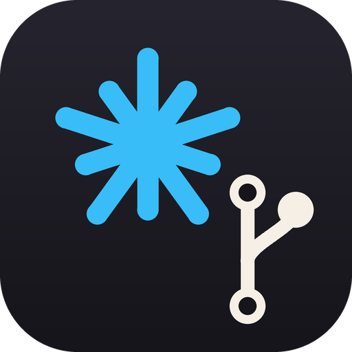

<p align="center"></p>

# Commit Pen

[](https://marketplace.visualstudio.com/items?itemName=ZakhariiMelnyk.commit-pen)
[](https://marketplace.visualstudio.com/items?itemName=ZakhariiMelnyk.commit-pen)
[](https://marketplace.visualstudio.com/items?itemName=ZakhariiMelnyk.commit-pen)
[](LICENSE)

Commit Pen writes Git commit messages for you. It reads the diff of your repository, sends it to Claude through the Claude Code CLI you are signed in to (or through the Anthropic API, if you prefer), and puts the result into the Source Control input box. You review it, tweak it if needed, and commit.

Upgrading from an earlier version? Your previous settings are copied to the new `commitPen.*` keys automatically on first start. If you use the API, run **Commit Pen: Set Anthropic API Key** once again.

> Commit Pen is an independent, community-built extension. It is not made, endorsed or supported by Anthropic. "Claude" and "Claude Code" are trademarks of Anthropic and are used here only to describe what the extension works with.

## Highlights

- **Generate from the Source Control title bar.** One click on the `$(sparkle)` action, or run **Commit Pen: Generate Commit Message** from the Command Palette.
- **CLI first, API as a fallback.** Uses the local Claude Code CLI when it is available, so no separate API key is needed. Switch to the Anthropic API with `commitPen.preferredMethod`.
- **Finds the CLI on its own.** Looks in PATH, in the binary shipped with the Claude Code VS Code extension, in your shell profile and in common install folders. The order is configurable, and it works in WSL, Remote-SSH and dev containers.
- **Your commit style.** Conventional Commits with or without scope, plain descriptions, or your own prompt template with `{diff}` and `{stats}` placeholders. Single-line or multi-line with body and footer, imperative or past tense.
- **Refine with feedback.** Not happy with the result? Choose **Edit with feedback**, describe what to change, and get a new version in the same format.
- **Four languages.** English, Korean, Ukrainian and Chinese commit messages.
- **Model choice.** Haiku, Sonnet or Opus, or any exact model ID via `commitPen.customModel`.
- **Several repositories at once.** Picks the repository you clicked in, or the one that contains the active editor.
- **Safe key storage.** The API key is kept in the OS secret storage, not in `settings.json`.
- **Cancellable and transparent.** Stop a run from the progress notification; every step is logged to the **Commit Pen** output channel.

## Requirements

- VS Code 1.75 or newer
- A Git repository open in the workspace
- One of:
  - the Claude Code CLI, installed and signed in, or
  - an Anthropic API key

### WSL

Leave `commitPen.cliPath` empty and the CLI is resolved at runtime on each side: `claude.exe` from the Windows PATH, `claude` from the Linux PATH. Your settings are never rewritten, so the same configuration works in both environments.

### Custom API endpoints

Environment variables such as `BASE_URI` or `ANTHROPIC_API_KEY` from your shell profile are picked up, because the CLI is started through a login shell (`-l`). Enterprise or proxy endpoints therefore work without extra settings.

## Getting started

1. Install **Commit Pen** from the VS Code Marketplace.
2. Make sure `claude --version` works in your terminal, or run **Commit Pen: Set Anthropic API Key**.
3. Open a folder with a Git repository and change some files. Staging is optional.
4. In the Source Control view, click the `$(sparkle)` action in the title bar.
5. Check the generated message in the input box and commit.

If the CLI cannot be found on the first run, the extension asks you to browse for it, type the path, or continue with the API. A running generation can be stopped with **Cancel** on the progress notification.

## Extension Settings

All settings are optional:

* `commitPen.cliPath`: Path to Claude CLI executable (leave empty for auto-detection)
* `commitPen.detectionOrder`: Order of the auto-detection sources (`path`, `vscodeExtension`, `shellProfile`, `commonPaths`) – first hit wins, defaults to `["path", "vscodeExtension", "shellProfile", "commonPaths"]`
* `commitPen.apiKey`: Your Anthropic API key (only needed if using API method). Prefer the command **Commit Pen: Set Anthropic API Key**, which stores the key in the OS secret storage instead of plain-text settings
* `commitPen.preferredMethod`: Choose AI backend (`auto`, `cli`, or `api`) – defaults to `auto`
* `commitPen.model`: Claude model to use (`haiku`, `sonnet`, `opus`) – defaults to `haiku`
* `commitPen.customModel`: Exact model ID or CLI alias that overrides `commitPen.model` (e.g. `claude-opus-5-5`, `sonnet[1m]`) – defaults to empty
* `commitPen.language`: Commit message language (`en` for English, `ko` for Korean, `ua` for Ukrainian, `zh` for Chinese) – defaults to `en`
* `commitPen.multiLineCommit`: Generate detailed multi-line commits with body and footer – defaults to `false`
* `commitPen.diffSource`: Which changes to use (`staged`, `all`, or `auto`) – defaults to `auto`
* `commitPen.claudeCodeManaged`: Let Claude Code generate commit messages with minimal intervention (only works with CLI method) – defaults to `false`
* `commitPen.keepCoAuthoredBy`: Keep Co-Authored-By signature in commit message (only works in Claude Code managed mode) – defaults to `false`
* `commitPen.messageAutoCloseSeconds`: Seconds before the success message is hidden into the Notification Center (0 to keep it on screen) – defaults to `5`
* `commitPen.showSuccessMessage`: Show a notification after the commit message is generated – defaults to `true`
* `commitPen.privacyMode`: *Deprecated, no effect* – since 1.0.20 the prompt is passed via stdin and never written to disk
* `commitPen.commitStyle`: Commit message style format (`conventional`, `prefix`, `default`, or `custom`) – defaults to `conventional`
* `commitPen.customPromptTemplate`: Custom prompt template with `{diff}` and `{stats}` variables (only used when commitStyle is `custom`) – defaults to empty

## Configuration Examples

### Auto-detection (recommended)
```json
{
    "commitPen.preferredMethod": "auto"
}
```
The extension will automatically search for Claude CLI in common locations, including the binary bundled with the official **Claude Code VS Code extension** (`anthropic.claude-code`), e.g. `~/.vscode-server/extensions/anthropic.claude-code-<version>/resources/native-binary/claude`. This works both locally and in remote sessions (Remote-SSH, WSL, dev containers).

### Custom detection order
```json
{
    "commitPen.detectionOrder": [
        "vscodeExtension",
        "path",
        "commonPaths",
        "shellProfile"
    ]
}
```
Sources are tried top to bottom and the first hit wins:

| Source | Where it looks |
|---|---|
| `path` | `which claude` / `where claude` |
| `vscodeExtension` | binary shipped with the Claude Code VS Code extension (local and remote install dirs) |
| `shellProfile` | PATH after sourcing `~/.zshrc` / `~/.bashrc` (macOS/Linux) |
| `commonPaths` | npm global, `~/.local/bin`, Homebrew, nvm, … |

Sources you omit are still tried last as a fallback, so detection never breaks. Setting `commitPen.cliPath` bypasses detection entirely.

### Manual CLI path (for NVM users or custom installations)
```json
{
    "commitPen.cliPath": "/home/dev/.nvm/versions/node/v20.18.1/bin/claude",
    "commitPen.preferredMethod": "cli"
}
```

### Using Anthropic API as fallback
Run **Commit Pen: Set Anthropic API Key** from the Command Palette — the key is kept in the OS secret storage (Keychain / Credential Manager / libsecret), not in `settings.json`. Then:
```json
{
    "commitPen.preferredMethod": "auto"
}
```
The key is looked up in this order: secret storage → `commitPen.apiKey` setting → `ANTHROPIC_API_KEY` environment variable. Secret storage is not covered by Settings Sync, so set the key once per machine.

### Korean interface
```json
{
    "commitPen.language": "ko"
}
```

### Ukrainian interface
```json
{
    "commitPen.language": "ua"
}
```

### Chinese interface
```json
{
    "commitPen.language": "zh"
}
```

### Detailed multi-line commits
```json
{
    "commitPen.multiLineCommit": true
}
```
This generates commits with subject, body, and footer following the full conventional commits format.

### Using a specific model
```json
{
    "commitPen.model": "sonnet"
}
```
Available models: `haiku` (fast, default), `sonnet` (balanced), `opus` (most capable). With the CLI these are aliases for the latest model of each family; with the API they map to `claude-haiku-4-5`, `claude-sonnet-5` and `claude-opus-5`.

To pin an exact model, set `customModel` — it takes precedence over `model`:
```json
{
    "commitPen.customModel": "claude-opus-5-5"
}
```

### Control diff source
```json
{
    "commitPen.diffSource": "staged"
}
```
Options: `auto` (default - uses staged if available, otherwise all), `staged` (only staged changes), `all` (all changes including unstaged).

### Claude Code managed mode
```json
{
    "commitPen.claudeCodeManaged": true,
    "commitPen.preferredMethod": "cli"
}
```
In this mode, Claude Code's haiku model generates commit messages with minimal intervention. Only a language hint is provided. Requires CLI method.

### Keep Co-Authored-By signature
```json
{
    "commitPen.claudeCodeManaged": true,
    "commitPen.keepCoAuthoredBy": true,
    "commitPen.preferredMethod": "cli"
}
```
Keeps the Co-Authored-By signature in commit messages. Only works in Claude Code managed mode.

### Customize auto-close timeout
```json
{
    "commitPen.messageAutoCloseSeconds": 10
}
```
Set to `0` to disable auto-close and keep the success message visible until manually dismissed. After the timeout the message moves to the Notification Center, where its buttons still work.

### Hide the success message
```json
{
    "commitPen.showSuccessMessage": false
}
```
Only the progress notification is shown while Claude is working, and it disappears as soon as the commit message is ready. Errors are still reported.

### Privacy mode for temporary files
`commitPen.privacyMode` is deprecated and has no effect: since 1.0.20 the prompt is passed to the CLI via stdin and never touches disk.

### Commit message styles

#### Conventional Commits (default)
```json
{
    "commitPen.commitStyle": "conventional"
}
```
Generates: `feat(auth): added user login`

#### Prefix only (without scope)
```json
{
    "commitPen.commitStyle": "prefix"
}
```
Generates: `feat: added user login`

#### Simple description (no prefix)
```json
{
    "commitPen.commitStyle": "default"
}
```
Generates: `added user login`

#### Custom prompt template
```json
{
    "commitPen.commitStyle": "custom",
    "commitPen.customPromptTemplate": "Generate a concise commit message following our team's style.\n\nChanges:\n{stats}\n\nDiff (first 6000 chars):\n{diff}\n\nFormat: <category>: <description>\nCategories: feature, bugfix, refactor, docs, test, chore\nReturn only the commit message."
}
```
Use `{diff}` for git diff content (automatically limited to first 6000 characters) and `{stats}` for change statistics. This allows complete control over the prompt sent to Claude.

## Multi-Repository Support

The extension intelligently handles workspaces with multiple Git repositories:

- **Context-aware**: Automatically detects which repository you're working in based on:
  - The Source Control panel you clicked from (highest priority)
  - The currently active editor's containing repository
  - First repository as fallback
- **No configuration needed**: Works seamlessly with VS Code's built-in multi-repo support
- **Per-repository commits**: Generate commit messages for the correct repository every time

## Troubleshooting

### Claude CLI not found

Commit Pen uses auto-detection to find Claude CLI **at runtime** without modifying your settings. If it's not found automatically:

1. **On first use**: The extension will prompt you to configure the path:
   - **Browse for CLI**: Opens a file picker to locate the executable
   - **Enter Path Manually**: Type the full path directly
   - **Skip (Use API)**: Fall back to API method (requires API key)

2. **Find your Claude CLI path manually**:
   ```bash
   which claude
   ```
   This shows the path (e.g., `/home/dev/.nvm/versions/node/v20.18.1/bin/claude`)

3. **Configure the path in settings** (only if needed):
   - Open VS Code Settings (Cmd+, or Ctrl+,)
   - Search for "commitPen.cliPath"
   - Paste the path from step 2
   - **Note**: Leave this empty for automatic runtime detection (recommended for WSL users)

4. **Auto-detection locations** (checked in order at runtime):
   - User-configured path in settings (if set)
   - In-memory cache (from previous detection in current session)
   - System PATH (via `which claude` or `where claude`)
   - Shell profile paths (~/.zshrc, ~/.bashrc on Unix-like systems)
   - Common installation paths:
     - `/usr/local/bin/claude`
     - `/opt/homebrew/bin/claude`
     - `~/.local/bin/claude`
     - `~/.nvm/versions/node/*/bin/claude` (NVM)
     - `~/.npm-global/bin/claude`

5. **Verify authentication**: Ensure Claude CLI is authenticated:
   ```bash
   claude --version
   ```

6. **Common issues**:
   - **WSL users**: Keep `commitPen.cliPath` empty to allow runtime detection in both Windows and WSL
   - **NVM users**: Auto-detection supports NVM paths via shell profile sourcing
   - **macOS**: The extension loads shell profiles to find paths
   - **Windows**: Checks the native installer (`~/.local/bin/claude.exe`) and common npm installation directories

### No commit message generated

1. Ensure you have changes in your repository (staged or unstaged)
2. Check that Claude CLI is properly authenticated
3. Try using API method as fallback:
   - Get API key from https://console.anthropic.com/
   - Run **Commit Pen: Set Anthropic API Key**
   - Set `commitPen.preferredMethod` to `api`

### Extension not working

1. Check you're in a Git repository
2. **Open Output panel** (View → Output) and select **"Commit Pen"** from the dropdown
3. Look for detailed log messages showing:
   - Where the extension is searching for Claude CLI
   - What command is being executed
   - What output (if any) is received from Claude
4. Try generating a commit message manually via Command Palette:
   - Press `Cmd+Shift+P` (or `Ctrl+Shift+P`)
   - Type "Commit Pen: Generate"
5. If CLI path is incorrect, clear `commitPen.cliPath` in settings to trigger re-detection

### "Empty response from CLI" error

This error means Claude CLI was found but didn't return any output. **Check the Output panel** (select "Commit Pen") for details:

1. **CLI Path**: Verify the detected path is correct
   - Look for "Found Claude CLI at: ..." in the logs
   - Test the path manually: run `<path> --version` in terminal

2. **Authentication**: Ensure Claude CLI is authenticated
   ```bash
   claude --version
   # Should show version without errors
   ```

3. **Command Execution**: Check the exact command being run
   - Look for "Executing: ..." in the logs
   - The command should pipe your changes to Claude CLI

4. **Common causes**:
   - **Not authenticated**: Run `claude` in terminal to authenticate
   - **Network issues**: Check your internet connection
   - **Corrupted install**: Reinstall Claude CLI (`npm install -g @anthropic-ai/claude-code`)
   - **Custom API endpoint**: Ensure environment variables for BASE_URI are properly set in your shell profile

### Using Custom API Endpoints

If you're using a custom Claude API endpoint (e.g., enterprise deployment):

1. **Set environment variables** in your shell profile (`.bashrc`, `.zshrc`, `.profile`):
   ```bash
   export BASE_URI="https://your-custom-endpoint.com"
   export ANTHROPIC_API_KEY="your-api-key"
   ```

2. **Reload your shell** or restart VS Code to apply changes:
   ```bash
   source ~/.bashrc  # or ~/.zshrc
   ```

3. **Verify the setup**:
   ```bash
   claude --version
   ```

The extension uses a login shell (`-l` flag) to ensure these environment variables are loaded when executing the Claude CLI.

## Privacy & Security

- The extension has no backend of its own: the diff goes only to Claude, through the CLI or the Anthropic API you configured
- Nothing is collected, stored or sent anywhere else, and there is no telemetry
- Sign-in is whatever your Claude Code CLI or API key already uses
- The API key set via **Commit Pen: Set Anthropic API Key** is kept in the OS secret storage, never in settings files
- The Claude CLI runs in a neutral temporary directory, so project files such as `CLAUDE.md` are not read
- The prompt reaches the CLI through stdin and is never written to disk

## Examples

Generated commit messages follow conventional commits format:

```
feat(auth): added Google OAuth provider
fix(api): fixed validation error in user endpoint
refactor(store): optimized cart state management
docs(readme): updated installation instructions
```

## Contributing

Bug reports, ideas and pull requests are welcome in the [issue tracker](https://github.com/uaoa/commit-pen/issues).

## Author

Created by **[Zakharii Melnyk](https://uaoa.github.io/)**, a Ukrainian full-stack engineer from Kyiv and founder of AOA. Builds web products, iOS apps and developer tools.

- Website: [uaoa.github.io](https://uaoa.github.io/)
- GitHub: [@uaoa](https://github.com/uaoa)
- LinkedIn: [undef-zakhar](https://www.linkedin.com/in/undef-zakhar/)
- YouTube: [@undefzakhar](https://www.youtube.com/@undefzakhar)
- Telegram: [@undefZakhar](https://t.me/undefZakhar)

Other projects:

- [whatsmyera.com](https://whatsmyera.com/): what happened during your lifetime
- [wherethefuckismy.money](https://wherethefuckismy.money/): real purchasing power calculator for incomes in Ukraine
- [AOA](https://aoa.com.ua/): on a mission to get people out more

## License

Released under the [MIT License](LICENSE).

